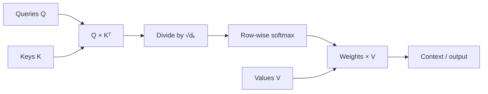

<div align="center">


# From Tokens to Attention

### CS5760 · Natural Language Processing · Home Assignment 4

**Three practical NLP implementations. Five core theory topics. One reproducible Python project.**

[](https://www.python.org/)
[](https://www.nltk.org/)
[](https://spacy.io/)
[](https://numpy.org/)
[](#project-information)

[**Explore the programs**](#programming-lab) · [**View results**](#output-gallery) · [**Run locally**](#quick-start) · [**Read theory**](#theory-in-five-concepts) · [**Presentation**](#visual-presentation)

</div>

---

## Overview

Natural Language Processing connects raw language to structured meaning. This repository follows that journey in three hands-on steps: **prepare text** with NLTK, **identify named entities** with spaCy, and **compute attention** with NumPy. The project also explains the sequence-to-sequence, attention, and Transformer concepts covered in the written portion of **Home Assignment 4**.

> **Goal:** Keep the implementations readable, commented, reproducible, and aligned with the assignment—not unnecessarily complicated.

| | Module | Main idea | Library | What it produces |
|:--:|---|---|---|---|
| **01** | NLP preprocessing | Tokenize → filter → stem | NLTK | Three ordered lists |
| **02** | Named entity recognition | Identify entities and spans | spaCy | Text, label, start and end offsets |
| **03** | Scaled dot-product attention | Score → scale → softmax → weight | NumPy | Attention matrix and output matrix |

<div align="center">
  
</div>

## Project information

| Field | Details |
|---|---|
| **Student** | Srinivas Reddy Pittu |
| **University** | University of Central Missouri (UCM) |
| **Department** | Computer Science & Cybersecurity |
| **Course** | CS5760 — Natural Language Processing |
| **Semester** | Fall 2026 |
| **Assignment** | Home Assignment 4 |
| **Parts** | Part I: five short-answer questions; Part II: three Python questions and their short answers |
| **Total points** | 100 (as stated in the assignment) |
| **Submission** | Publish the source code on GitHub and submit the repository URL on Brightspace |

## Programming lab

### 01 — NLP preprocessing with NLTK

**File:** [`src/q1_preprocessing.py`](src/q1_preprocessing.py)

The function takes the exact assignment sentence and applies three operations in order.

```text
INPUT
"NLP techniques are used in virtual assistants like Alexa and Siri."
                    │
                    ▼
TOKENIZE      →  Keep individual words and punctuation
                    │
                    ▼
STOPWORDS     →  Remove common English words and punctuation
                    │
                    ▼
PORTER STEM   →  Reduce remaining words to stems
```

<details>
<summary><b>View verified Q1 console output</b></summary>

```text
Original Tokens: ['NLP', 'techniques', 'are', 'used', 'in', 'virtual', 'assistants', 'like', 'Alexa', 'and', 'Siri', '.']
Tokens Without Stopwords: ['NLP', 'techniques', 'used', 'virtual', 'assistants', 'like', 'Alexa', 'Siri']
Stemmed Words: ['nlp', 'techniqu', 'use', 'virtual', 'assist', 'like', 'alexa', 'siri']
```

</details>

**What to notice:** `techniques → techniqu`, `used → use`, and `assistants → assist`. A stem does not need to be a dictionary word. The script supports NLTK's full English stopword corpus, with a small fallback list if that corpus is not available.

**Related short answers:** Stemming usually trims words to stems; lemmatization returns vocabulary-based lemmas (`running → run` in both examples). Stopword removal can improve keyword tasks, but can hide important context such as negation (`not`).

### 02 — Named Entity Recognition with spaCy

**File:** [`src/q2_named_entity_recognition.py`](src/q2_named_entity_recognition.py)

The program loads `en_core_web_sm`, processes the **exact assignment sentence (including its leading space)**, and prints each entity's text, label, starting character and exclusive ending character.


| Observed entity | spaCy label | Start | End (exclusive) |
|---|:---:|---:|---:|
| LeBron James | `PERSON` | 1 | 13 |
| NBA | `ORG` | 21 | 24 |
| the United States | `GPE` | 35 | 52 |
| Laker | `GPE` | 56 | 61 |
| MVP | `ORG` | 84 | 87 |
| 2020 | `DATE` | 91 | 95 |

> **Model-output note:** These six rows reproduce the spaCy output shared from the student's run. Entity predictions depend on the spaCy model/version. In this run, `Laker` was tagged as `GPE` although the sentence refers to a basketball team. This is a model classification issue, not a character-offset or Python logic issue. The code reports actual predictions without hard-coding labels.

**Related short answers:** Named Entity Recognition identifies people, organizations, places, dates, etc.; POS tagging instead assigns grammatical classes such as noun or verb. NER is useful for extracting companies from financial news and identifying people or locations in search.

### 03 — Scaled dot-product attention with NumPy

**File:** [`src/q3_scaled_dot_product_attention.py`](src/q3_scaled_dot_product_attention.py)

This NumPy implementation follows the standard formula from the assignment:

$$
\operatorname{Attention}(Q,K,V)=\operatorname{softmax}\left(\frac{QK^T}{\sqrt{d_k}}\right)V
$$



The supplied test matrices are:

```python
Q = np.array([[1, 0, 1, 0], [0, 1, 0, 1]])
K = np.array([[1, 0, 1, 0], [0, 1, 0, 1]])
V = np.array([[1, 2, 3, 4], [5, 6, 7, 8]])
```


**Verified output (rounded to three decimal places):**

```text
Attention Weights:
 [[0.731 0.269]
 [0.269 0.731]]
Final Output Matrix:
 [[2.076 3.076 4.076 5.076]
 [3.924 4.924 5.924 6.924]]
```

**Why scaling matters:** Dividing by `√dₖ` prevents large dot products from making softmax overly sharp, helping gradient-based optimization. Self-attention also lets words use information from other relevant words across the sentence.

## Theory in five concepts

These are brief study notes; the full written answers and calculations are in [`assignment/answers.md`](assignment/answers.md) and the [completed Word assignment](assignment/Home_Assignment_4_Completed.docx).

| Part I question | Key concepts | Main takeaway |
|---|---|---|
| **Q1 · Seq2Seq & attention** | Encoder, decoder, context vector | Attention provides access to all encoder hidden states instead of relying only on one fixed-length summary. |
| **Q2 · Attention mechanisms** | Hard vs. soft attention, dot product, softmax | Soft attention assigns differentiable weights; for scores `[1, 0, 1]`, weights ≈ `[0.422, 0.155, 0.422]` and context ≈ `[0.845, 0.578]`. |
| **Q3 · Transformer self-attention** | Query, Key, Value; long-distance dependencies | Every token can directly use relevant information from other positions in the sequence. |
| **Q4 · Multi-head attention** | Parallel heads, concatenation, linear projection | With embedding dimension 512 and 8 heads, each head has **512 ÷ 8 = 64** dimensions. |
| **Q5 · Transformer architecture** | Position, causal masks, parallelism | Positional information preserves order; causal masks block future tokens; generation remains sequential. |

## Output gallery

<div align="center">

| Preprocessing | Named entities | Attention |
|---|---|---|
|  |  |  |

</div>

The result files are also available as plain text: [Q1 output](outputs/q1_sample_output.txt) · [Q2 observed run](outputs/q2_observed_output.txt) · [Q3 output](outputs/q3_sample_output.txt).

## Quick start

### 1. Requirements

- Python **3.10 or later**
- `nltk`, `spacy`, and `numpy` (listed in [`requirements.txt`](requirements.txt))
- The spaCy **`en_core_web_sm`** model for Q2

### 2. Create an environment and install dependencies

**Windows PowerShell**

```powershell
python -m venv .venv
.\.venv\Scripts\Activate.ps1
python -m pip install -r requirements.txt
python -m spacy download en_core_web_sm
python -m nltk.downloader stopwords
```

**macOS / Linux**

```bash
python3 -m venv .venv
source .venv/bin/activate
python -m pip install -r requirements.txt
python -m spacy download en_core_web_sm
python -m nltk.downloader stopwords
```

The NLTK stopword download is recommended but optional for Q1 because the code has a small fallback list. The tokenization uses `preserve_line=True`, so downloading NLTK's `punkt` data is **not** required for this script.

### 3. Run the programs

```bash
python src/q1_preprocessing.py
python src/q2_named_entity_recognition.py
python src/q3_scaled_dot_product_attention.py
```

### 4. Run the test

```bash
python -m unittest discover -s tests -v
```

**Local verification:** Q1 and Q3 execute with the expected outputs. The attention unit test passes. Q2's observed entities are documented from the student's spaCy run; classification labels are model-dependent.

### 5. Explore the notebook

Open [`notebooks/Home_Assignment_4.ipynb`](notebooks/Home_Assignment_4.ipynb) using Jupyter Notebook, JupyterLab, VS Code, or Google Colab. Install the packages and spaCy model in the chosen environment, then run all cells in order. Some notebook cells return Python lists as well as printing results; Jupyter may show both unless the cell's final return value is suppressed.

## Repository structure

```text
nlp-from-tokens-to-attention/
├── README.md                        # Project home page
├── GITHUB_REPO_DETAILS.md           # Name, description and tags
├── requirements.txt                 # Python dependencies
├── .gitignore
├── assignment/
│   ├── Home_Assignment_4_Completed.docx
│   └── answers.md                  # Complete theory + programming solutions
├── src/
│   ├── q1_preprocessing.py
│   ├── q2_named_entity_recognition.py
│   └── q3_scaled_dot_product_attention.py
├── notebooks/
│   └── Home_Assignment_4.ipynb
├── tests/
│   └── test_attention.py
├── outputs/
│   ├── q1_sample_output.txt
│   ├── q2_observed_output.txt
│   ├── q2_model_note.txt
│   └── q3_sample_output.txt
├── docs/
│   └── assets/
│       ├── hero.png
│       ├── preprocessing_pipeline.png
│       ├── ner_results.png
│       ├── attention_results.png
│       └── presentation_preview.png
└── presentation/
    ├── CS5760_NLP_Assignment_4_Visual_Presentation.pptx
    └── CS5760_NLP_Assignment_4_Visual_Presentation.pdf
```

## Visual presentation

The [`presentation/`](presentation/) directory contains a **9-slide visual walkthrough** of the project, covering its objectives, theory concepts, diagrams, code workflow, observed results, setup, and submission checklist.


**Presentation formats:** [Editable PowerPoint](presentation/CS5760_NLP_Assignment_4_Visual_Presentation.pptx) · [Viewable PDF](presentation/CS5760_NLP_Assignment_4_Visual_Presentation.pdf). All README images are stored locally under [`docs/assets/`](docs/assets/), so they remain visible on GitHub.

## GitHub & Brightspace submission

1. Create a GitHub repository named **`nlp-from-tokens-to-attention`**.
2. Upload the **contents** of the repository ZIP, keeping the folders and file names unchanged.
3. Check that `README.md` displays correctly and all images load on GitHub.
4. Confirm that `src/`, `notebooks/`, `assignment/`, `tests/`, and `presentation/` are present.
5. Copy the **actual GitHub repository link** and submit it on **Brightspace**, following your instructor's deadline.

For the repository description, social preview and recommended GitHub topic tags, see [`GITHUB_REPO_DETAILS.md`](GITHUB_REPO_DETAILS.md).

If you prefer Git, replace `YOUR_GITHUB_USERNAME` with your real username:

```bash
git init
git add .
git commit -m "Complete CS5760 NLP Assignment 4"
git branch -M main
git remote add origin https://github.com/YOUR_GITHUB_USERNAME/nlp-from-tokens-to-attention.git
git push -u origin main
```

---

<div align="center">

**From raw language to contextual understanding.**

*CS5760 Natural Language Processing · University of Central Missouri · Fall 2026*

*Prepared by Srinivas Reddy Pittu*

</div>
